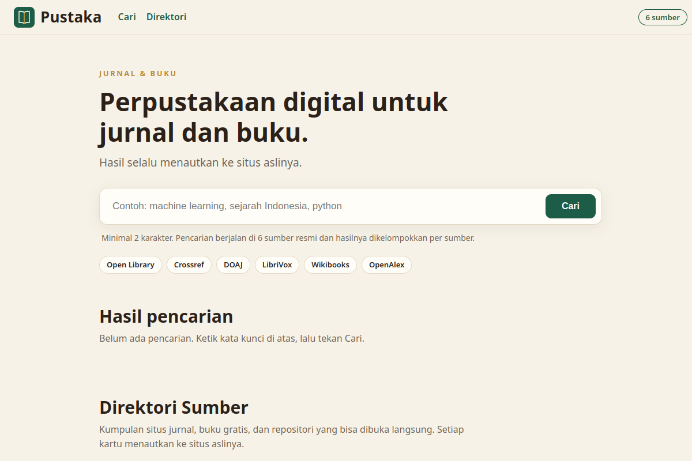
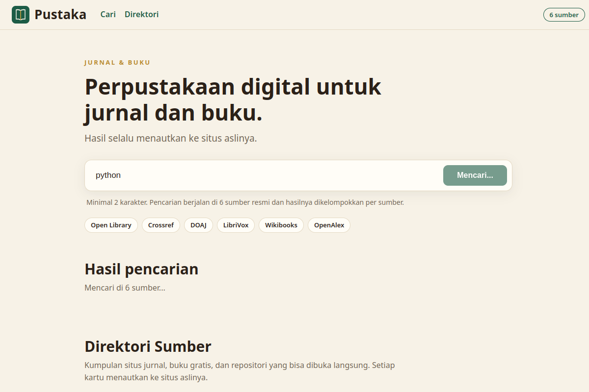

# Pustaka

A digital library for journals and books. Search six live sources at once, every result links to the original site.

Live: https://pustaka.xsrazy.web.id

## About

Pustaka is a dedicated journal and book search site with an Indonesian interface. Type one keyword and it queries six live scholarly and book sources in parallel, then groups the results per source. A directory of 24 journal, free book, and repository sites sits below the search, and every link on the page points to the original site. The search results themselves are never hosted here.

## Features

- One search across six live sources: Open Library, Crossref, DOAJ, LibriVox, Wikibooks, and OpenAlex, with up to 10 results per source. One failing source never fails the whole response.
- Per-source status, result counts, and timings on every search. Titles and descriptions are stripped of HTML and truncated at word boundaries.
- Keyword validation: the query must be at least 2 characters, enforced in the browser and by the API.
- Shareable searches: the `?q=` URL parameter runs the search on load and stays in sync with the search box.
- A 24-entry directory of journal, free book, and repository sites in four groups, with a live filter. Every card links to the original site in a new tab.
- One-hour server-side caching of search responses.
- Rendering is XSS-safe: all page content is inserted as text, never as HTML. A script payload typed into the search box renders only as harmless text.
- SEO, Open Graph and Twitter cards, JSON-LD, `robots.txt`, and a sitemap.

## Screenshots

Homepage:

Search running for "python" (captured while results were loading; the `?q=` parameter auto-runs the search):

## Architecture

Zero-dependency Node.js on Vercel, no framework, no build step, no database.

- Frontend: `index.html` plus `assets/app.js` and `assets/styles.css`. Vanilla JavaScript fetches the search endpoint, renders results grouped per source, and filters the directory.
- Backend: `api/search.js` (the search aggregator) and `api/_lib.js` (shared helpers: JSON responses, query parsing, timeout fetch, in-memory cache, HTML stripping, word-boundary truncation). One file per endpoint, only Node.js built-ins plus `fetch`.
- Data: `journals.json` holds the 28 directory entries (4 hidden, 24 displayed) with their groups and notes.
- Hosting and deploy: Vercel project `pustaka` at `pustaka.xsrazy.web.id`. The project is connected to this repository, so every push to `main` auto-deploys. Function limit is 30 seconds for `/api/search`.

## API

| Endpoint | Method | Parameters | Response |
|---|---|---|---|
| `/api/search` | GET | `q` (required, minimum 2 characters) | JSON: `query`, `checkedAt`, `sources` (name, status, count, ms), `results` grouped per source |

Rules: GET only (other methods return 405). A missing or too-short `q` returns a clean 400. Responses are cached for one hour. Semantic Scholar and Gutendex are disabled in code because their upstreams return errors; re-enabling either one is a single-flag change.

## Environment Variables

No environment variables are required.

## Notes

- Last verified November 4, 2026: the site is live at `pustaka.xsrazy.web.id`, search returns results from 5 of 6 sources, and the directory shows 24 entries.
- LibriVox is kept as a search source. It returns 0 results for queries with no match because its feed ignores search parameters; that is the feed's documented behavior, not a bug.
- Search results belong to their respective sources. Liveness of the sources is not probed on a schedule; each search queries them live.

## Credits

- Search sources: Open Library, Crossref, DOAJ, LibriVox, Wikibooks, OpenAlex.
- Pustaka began as the journal and book section of API Hub, split into its own site.

## License

MIT License

Copyright (c) 2026 Rahmatul Usra
